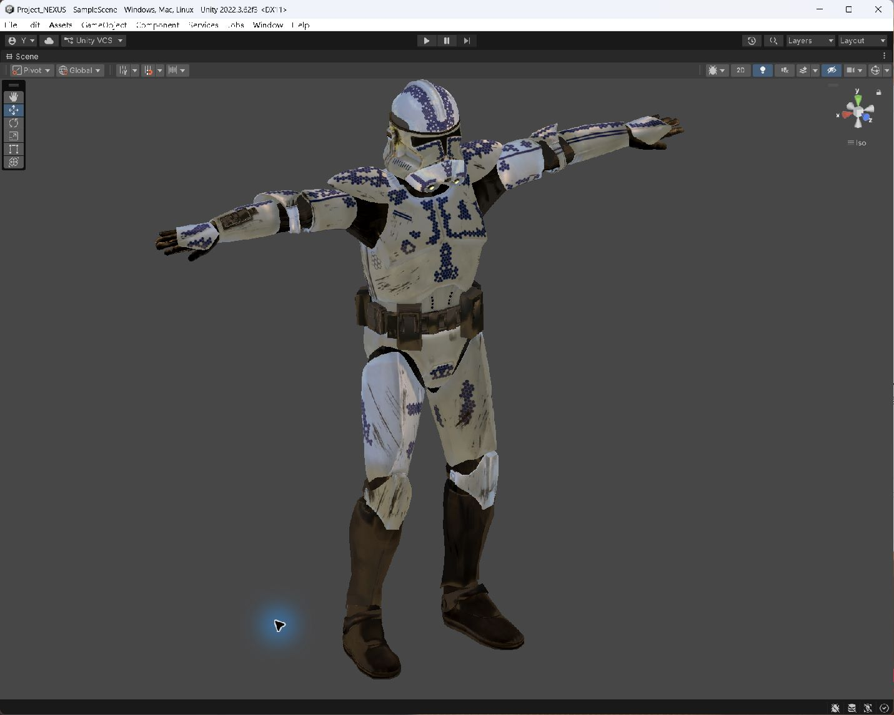

# Project NEXUS

基于 Unity URP 的角色渲染学习与实验项目。使用 HLSL 编写自定义 Shader，围绕科幻盔甲角色练习 PBR 光照、材质表现与环境反射。

## 效果展示



*Unity Scene 视图实际截图。*

## 主要内容

- 基于 GGX、Smith 和 Schlick Fresnel 的直接光照计算。
- 支持基础色、法线、金属度、粗糙度、AO 和自发光贴图。
- 环境漫反射、环境镜面反射及可调节的菲涅尔边缘光。
- 主光源阴影接收与 ShadowCaster Pass。
- 头盔、身体和腿部独立材质，便于调试不同部位的表现。

## 运行环境

- Unity **2022.3.62f3**
- Universal Render Pipeline（URP）**14.0.12**

通过 Unity Hub 添加并打开项目，等待依赖恢复和资源导入后，打开 `Assets/Scenes/SampleScene.unity`。在 Scene 视图观察角色，在 `Assets/NEXUS/Shader/Material` 中选择材质调整参数。

## 项目结构

```text
Assets/
├── NEXUS/
│   ├── Shader/Clone_LP.shader  # 核心角色 Shader
│   ├── Shader/Material/       # 角色材质
│   ├── Shader/debug/          # Shader 实验记录
│   └── Rsc/                  # 模型、贴图和环境资源
├── Scenes/                   # 示例场景
└── Settings/                 # 渲染配置
```

当前重点为 Shader 与渲染效果实验，尚未包含完整的游戏玩法系统。模型与贴图包含第三方资源，其权利归原作者所有；使用或再分发时请遵循各自的授权条款。
